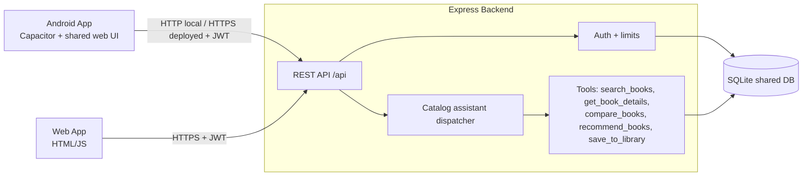

# E-Library AI — Technical Documentation (Phase 1 and Phase 2 Foundation)

## 1. System overview
E-Library AI is a digital library where users find and download **legally free** books (public domain / open license), with an AI assistant embedded in both a website and an Android app. Both clients share one REST API and one database.

- **Target users:** students and general readers; administrators manage the catalog.
- **Guest Mode:** no account, max **5** downloads per guest session.
- **Registered Mode:** max **10** downloads per account, favorites, My Library.
- **Catalog:** 20 seeded public-domain books; admins can add, edit, and delete entries.

## 2. Technology stack & justification
| Layer | Choice | Why |
|---|---|---|
| Android | Capacitor Android shell reusing the HTML/CSS/JavaScript client | Shares the existing web UI and calls the same REST API |
| Web frontend | HTML/CSS/vanilla JS SPA | No build step; easy to deploy and explain line by line |
| Backend | Node.js 22 + Express | Small, widely supported, simple REST |
| Database | SQLite (better-sqlite3) | Zero-config, relational, one file shared by every client through the API |
| Auth | bcryptjs + JWT (7 days) | Stateless; same token flow for web and Android |
| Security | helmet (CSP), CORS, rate limiting, input validation, parameterized SQL | Meets cybersecurity requirement |
| AI assistant | Backend catalog tools with signed confirmation for library writes | Tool actions operate on the shared database; an LLM provider is not configured |
| DevOps | Docker, GitHub Actions, Render hosting | Container deployment and automated builds |

## 3. Architecture

## 4. Database design
- `users(id, full_name, email UNIQUE, password_hash, role, created_at)`
- `guest_sessions(id UUID, created_at)`
- `books(id, title, author, category, description, cover_url, download_url, license, source, year, UNIQUE(title,author))`
- `favorites(user_id, book_id)` · `library(user_id, book_id, added_via)`
- `downloads(id, user_id XOR guest_id, book_id, created_at)` — CHECK ensures exactly one owner
- `ai_tool_logs(id, user_id, tool_name, arguments, result, created_at)` — used from Phase 2

## 5. REST API (implemented)
| Method & path | Auth | Purpose |
|---|---|---|
| POST `/api/auth/register` | – | Create account |
| POST `/api/auth/login` | – | Login → JWT |
| POST `/api/auth/guest` | – | Start guest session → JWT |
| POST `/api/auth/logout` | opt | Logout (client discards token) |
| GET `/api/auth/me` | ✔ | Profile + download usage |
| GET `/api/books?q=&category=&author=&page=&limit=` | opt | Search / filter |
| GET `/api/categories`, `/api/books/:id` | – | Metadata |
| POST `/api/books/:id/download` | ✔ | Enforces 5 / 10 limit, returns legal URL |
| GET/PUT/DELETE `/api/favorites[/:id]`, `/api/library[/:id]` | registered | Sync across clients |
| GET `/api/admin/stats` | admin | Dashboard counts |
| GET `/api/admin/books` | admin | List/search books for management |
| POST/PUT/DELETE `/api/admin/books[/:id]` | admin | Create, update, and delete catalog entries |
| GET `/api/ai/architecture` | – | Assistant tools and safety details |
| POST `/api/ai/chat` | ✔ | Search, detail, compare, recommend, or request a confirmed library save |

## 6. Embedded catalog assistant
The shared chat panel is available to web and Android users. The backend dispatches `search_books`, `get_book_details`, `compare_books`, `recommend_books`, and `save_to_library` actions against the SQLite catalog. A save request returns a short-lived signed confirmation token; the write occurs only when the user explicitly confirms it. Tool invocations are written to `ai_tool_logs`.

The current implementation uses built-in intent matching and database tools; it does not call an LLM. A generative model can be added later with its API key stored only in server environment settings.

## 7. Administrator book management
The web admin dashboard lists catalog entries and provides add/edit/delete forms. The API validates required fields, restricts download links to HTTPS, prevents duplicate title-author pairs, and enforces the admin role on every management route.

## 8. Security measures so far
Android debug builds permit HTTP and mixed content for local development. Release builds keep both disabled; deployed backends should use HTTPS.

Password hashing (bcrypt), JWT auth, role checks (user/admin/guest), backend-enforced download limits inside a DB transaction, validated inputs, parameterized queries, CSP + secure headers, auth rate limiting, HTML escaping in the web client, HTTPS-only network config on Android (cleartext only for local dev hosts).

## 9. Testing
`backend/test/api.test.js` covers health/catalog, registration/login/logout, search/filter, download limits, favorites/library, admin authorization and CRUD, title-specific covers, and assistant tool execution and confirmation. The shared admin and chat UI were also smoke-tested in a browser.

## 10. Remaining work
1. Expand catalog to 200+ unique Project Gutenberg books via import script.
2. Configure a generative AI provider and add provider-backed reasoning.
3. Android polish (offline cache); deploy with persistent SQLite storage or migrate to a hosted database.

## 11. Known risks
- SQLite file storage must be on persistent disk in production. Render's free instance does not provide a persistent disk.
