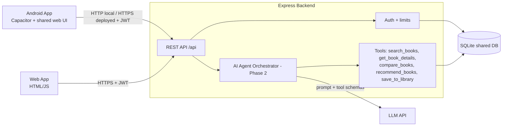

# E-Library AI — Initial Technical Documentation (Phase 1)

## 1. System overview
E-Library AI is a digital library where users find and download **legally free** books (public domain / open license), with an AI assistant embedded in both a website and an Android app. Both clients share one REST API and one database.

- **Target users:** students and general readers; administrators manage the catalog.
- **Guest Mode:** no account, max **5** downloads per guest session.
- **Registered Mode:** max **10** downloads per account, favorites, My Library.
- **Catalog goal:** 200+ unique books (20 seeded in Phase 1).

## 2. Technology stack & justification
| Layer | Choice | Why |
|---|---|---|
| Android | Capacitor Android shell reusing the HTML/CSS/JavaScript client | Shares the existing web UI and calls the same REST API |
| Web frontend | HTML/CSS/vanilla JS SPA | No build step; easy to deploy and explain line by line |
| Backend | Node.js 22 + Express | Small, widely supported, simple REST |
| Database | SQLite (better-sqlite3) | Zero-config, relational, one file shared by every client through the API |
| Auth | bcryptjs + JWT (7 days) | Stateless; same token flow for web and Android |
| Security | helmet (CSP), CORS, rate limiting, input validation, parameterized SQL | Meets cybersecurity requirement |
| AI (Phase 2) | LLM with tool/function calling, run server-side | Real tool-based actions on real data |
| DevOps | Docker, GitHub Actions, Wasmer hosting | Required by the exam |

## 3. Architecture

## 4. Database design
- `users(id, full_name, email UNIQUE, password_hash, role, created_at)`
- `guest_sessions(id UUID, created_at)`
- `books(id, title, author, category, description, cover_url, download_url, license, source, year, UNIQUE(title,author))`
- `favorites(user_id, book_id)` · `library(user_id, book_id, added_via)`
- `downloads(id, user_id XOR guest_id, book_id, created_at)` — CHECK ensures exactly one owner
- `ai_tool_logs(id, user_id, tool_name, arguments, result, created_at)` — used from Phase 2

## 5. REST API (implemented)
| Method & path | Auth | Purpose |
|---|---|---|
| POST `/api/auth/register` | – | Create account |
| POST `/api/auth/login` | – | Login → JWT |
| POST `/api/auth/guest` | – | Start guest session → JWT |
| POST `/api/auth/logout` | opt | Logout (client discards token) |
| GET `/api/auth/me` | ✔ | Profile + download usage |
| GET `/api/books?q=&category=&author=&page=&limit=` | opt | Search / filter |
| GET `/api/categories`, `/api/books/:id` | – | Metadata |
| POST `/api/books/:id/download` | ✔ | Enforces 5 / 10 limit, returns legal URL |
| GET/PUT/DELETE `/api/favorites[/:id]`, `/api/library[/:id]` | registered | Sync across clients |
| GET `/api/admin/stats` | admin | Dashboard counts |
| GET `/api/ai/architecture` | – | Planned agent design |

## 6. Planned AI agent (Phase 2)
`POST /api/ai/chat {message, conversationId}` → backend sends conversation + tool schemas to the LLM → LLM requests a tool → backend executes it under the caller's JWT against the real DB → result returned to LLM → final answer to the app. `save_to_library` is two-step: the agent asks for confirmation, and only an explicit "yes" triggers the write. Every call is logged in `ai_tool_logs`. The chat panel is built into both clients (no external redirect).

## 7. Security measures so far
Android debug builds permit HTTP and mixed content for local development. Release builds keep both disabled; deployed backends should use HTTPS.

Password hashing (bcrypt), JWT auth, role checks (user/admin/guest), backend-enforced download limits inside a DB transaction, validated inputs, parameterized queries, CSP + secure headers, auth rate limiting, HTML escaping in the web client, HTTPS-only network config on Android (cleartext only for local dev hosts).

## 8. Testing
`backend/test/api.test.js` (7 passing tests): health/catalog, register/login/logout, duplicate & weak-password rejection, search/filter, guest 5-download cap, user 10-download cap, favorites/library, admin-only access. The web UI was also exercised end-to-end in a headless browser.

## 9. Phase 2 plan (Nov 21)
1. Expand catalog to 200+ unique Project Gutenberg books via import script.
2. Admin: add/edit/delete books, analytics.
3. Implement AI agent + five tools; chat UI on web and Android.
4. Android polish (detail screen, offline cache); more tests; deploy to Wasmer.

## 10. Known risks
- Wasmer Edge may not support the native `better-sqlite3` module; fallback is a Docker-based host or swapping to a pure-JS/WASM SQLite.
- SQLite file storage must be on persistent disk in production.
